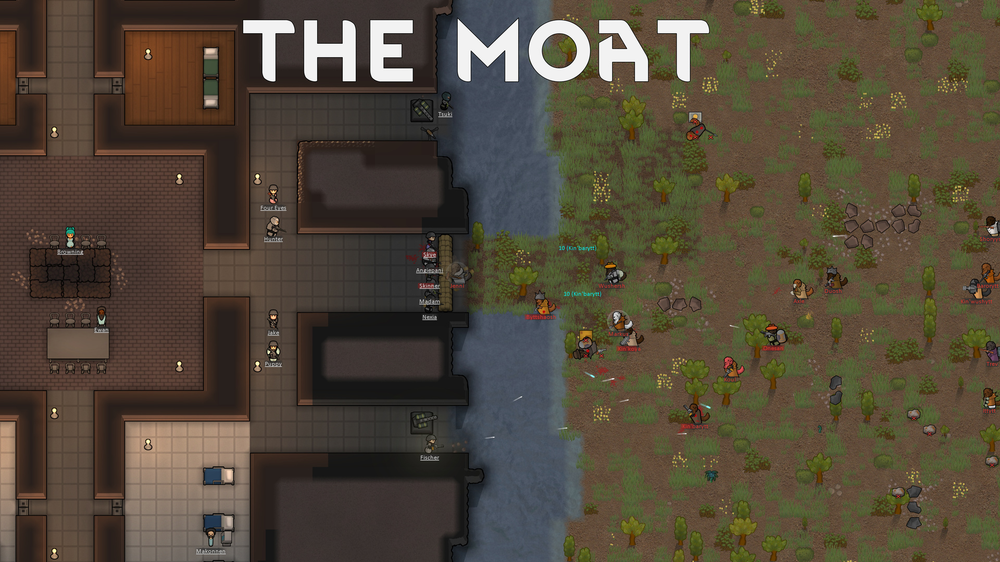

# The Moat

  

  
  
  

A RimWorld mod that forces your starting colony map (and only that map) to generate with an impassable mountain along one side and open plains on the rest. Built for players who want a subterranean colony with one or a few choke points.

## Defensive highlights

- You can build your mountain base deep, with no caves (unless you switch them on in the mod options), no surprise internal open spaces or ancient dangers. Ores are present normally.
- You can design the base for a single choke point: every raid, manhunter pack and mechanoid threat comes from the plains side.
- No drop pods through the roof: the whole mountain is covered by thick overhead mountain.
- Concentrated defenses: no 360-degree perimeter to defend. Put your turrets, bunkers and traps at the entrance.
- If you want full relax: combine this mod with the "no infestations" one.

## Map generation

- Choose your side: the mountain sits on the west side by default. Move it to the east, north or south side in the mod settings.
- The mountain: solid rock with thick overhead roof. No caves (unless you turn them on in the mod options), no hollow pockets, no insect hives, no special features (ancient dangers, ruins, geysers, monolith). Only mineable ore veins, at the density of a vanilla mountainous map, even on flat tiles.
- The plains: flat open land without hills or lakes. All vanilla surface features spawn there: trees, soil types, ancient dangers, ancient mech remains, steam geysers, ruins, roads, the Anomaly Void Monolith and wildlife.
- Starting colony only: later settlements, quest sites, encounter maps and camps generate normal vanilla maps.

## Mod settings

Options > Mod Settings > The Moat:

- Mountain side: west, east, north or south (default: west).
- Mountain size: 30% to 70% of the map (default: 50%).
- Edge roughness: from a straight cliff line (0%, default) to a ragged mountain foot with bays and spurs (100%).
- Caves inside the mountain (default: OFF): natural tunnels like vanilla caves, kept at least 12 cells from the plains and 8 from the map edges, so they never open a second way in. No insect hives.
- Ore veins in the mountain (default: ON).
- Remove lakes and water on the plains (default: ON).
- Flatten hills on the plains (default: ON).

The settings are translated into Italian, French, German and Spanish (`Languages/`); other languages show English.

## Requirements

- [Harmony](https://steamcommunity.com/sharedfiles/filedetails/?id=2009463077) is required. Load it at the top of your mod list.
- No DLC required. Works with Royalty, Ideology, Biotech, Anomaly and Odyssey.
- Compatible with RimWorld 1.6 and 1.7.

## Installation

From the Steam Workshop: subscribe to [The Moat](https://steamcommunity.com/sharedfiles/filedetails/?id=3813355538) and [Harmony](https://steamcommunity.com/sharedfiles/filedetails/?id=2009463077), enable both in the Mods menu with Harmony at the top, and start a new game.

Manual installation: clone this repository into `<Steam>/steamapps/common/RimWorld/Mods/TheMoat`, then enable Harmony and The Moat in the Mods menu.

## Building from source

The same code is built for both RimWorld versions: `1.6/Assemblies` (.NET Framework 4.7.2, Harmony 2) and `1.7/Assemblies` (.NET 10, Harmony 3). Install the [.NET 10 SDK](https://dotnet.microsoft.com/download) and run `build.bat`, or `dotnet build TheMoat.csproj -c Release`. `build.bat` also copies the game files to `RimWorld/Mods/TheMoat`.

## Updating the Workshop item

`About/PublishedFileId.txt` holds the Workshop item ID (3813355538), so uploading from the game updates the existing item:

1. Enable Development mode in RimWorld's options.
2. Open Mods, select The Moat, click Advanced..., then Upload to Steam Workshop.

Uploading replaces the files but not the Workshop description, which is edited on the Workshop page.
